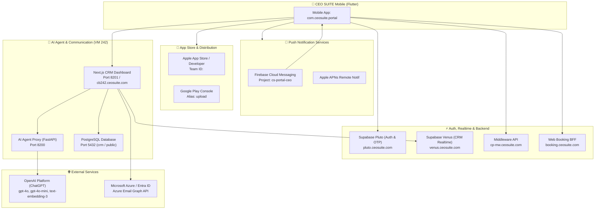

# [TEMPLATE] Katalog Akun & Integrasi Ekosistem CEO SUITE (Mobile & AI CRM)

> [!WARNING]
> Ini adalah template dokumentasi (**CONTOH**). Jangan pernah memasukkan kredensial asli/rahasia produksi ke dalam file ini. File ini aman untuk di-commit ke Git. Untuk konfigurasi rahasia lokal, gunakan `docs/INTEGRATED_ACCOUNTS.md` (sudah di-ignore oleh Git).

---

## 🗺️ Arsitektur Aliran Integrasi

---

## 1. 🔔 Google Firebase (FCM & Firebase Crashlytics)

| Parameter | Nilai / Konfigurasi | Keterangan |
| :--- | :--- | :--- |
| **Project Name** | `cs-portal-ceo` | Nama Project di Firebase Console |
| **Project Number** | `<FIREBASE_PROJECT_NUMBER>` | Project Number / GCM Sender ID |
| **Storage Bucket** | `cs-portal-ceo.firebasestorage.app` | Default Storage Bucket Firebase |
| **Android Client App ID** | `1:<PROJECT_NUMBER>:android:<HASH>` | Didaftarkan untuk package `com.ceosuite.portal` |
| **Android API Key** | `<REDACTED_FIREBASE_ANDROID_API_KEY>` | Terpasang di `android/app/google-services.json` |
| **iOS Client App ID** | `1:<PROJECT_NUMBER>:ios:<HASH>` | Didaftarkan untuk bundle `com.ceosuite.portal` |
| **iOS API Key** | `<REDACTED_FIREBASE_IOS_API_KEY>` | Terpasang di `ios/Runner/GoogleService-Info.plist` |

---

## 2. 🍎 Apple Developer & Apple App Store Connect

| Parameter | Nilai / Konfigurasi | Keterangan |
| :--- | :--- | :--- |
| **Apple Developer Team ID** | `<APPLE_TEAM_ID>` | ID Tim Organisasi Pengembang Apple |
| **Bundle Identifier** | `com.ceosuite.portal` | Identitas unik bundle aplikasi iOS |
| **Application Name** | `CEO SUITE` | Nama display di layar springboard pengguna |
| **URL Scheme** | `ceosuiteportal://` | Custom URL Scheme untuk deep link / OAuth return |

---

## 3. 🤖 Google Play Store & Android App Signing

| Parameter | Nilai / Konfigurasi | Keterangan |
| :--- | :--- | :--- |
| **Package Name (ID)** | `com.ceosuite.portal` *(UAT)* `com.ceosuite.ceosuiteapp` *(Production)* | Android Application ID |
| **Keystore File** | `upload-keystore.jks` | Terletak di direktori `android/upload-keystore.jks` |
| **Key Alias** | `upload` | Alias kunci penandatanganan aplikasi |
| **Keystore Password** | `<REDACTED_KEYSTORE_PASSWORD>` | Disimpan aman di `android/key.properties` (ignored) |
| **Key Password** | `<REDACTED_KEY_PASSWORD>` | Disimpan aman di `android/key.properties` (ignored) |

---

## 4. 🧠 OpenAI Platform (ChatGPT & AI Agents)

| Parameter | Nilai / Konfigurasi | Keterangan |
| :--- | :--- | :--- |
| **Provider** | **OpenAI API** (`platform.openai.com`) | Akun Billing & API Platform |
| **Base URL** | `https://api.openai.com/v1` | Endpoint REST resmi OpenAI |
| **API Key Reference** | `sk-proj-...<REDACTED_OPENAI_API_KEY>` | Dikelola di `ai-agent-proxy/.env` (`OPENAI_API_KEY`) |
| **Model Percakapan Cepat** | `gpt-4o-mini` | Untuk balasan cepat & tugas klasifikasi intent ringan |
| **Model Percakapan Kompleks** | `gpt-4o` | Untuk interaksi agen tingkat lanjut & multi-turn dialog |
| **Embedding Model (RAG)** | `text-embedding-3-small` (1536 dim) | Vektorisasi dokumen Knowledge Base CEO SUITE |

---

## 5. 📧 Microsoft Azure / Entra ID (Azure Email Graph API)

| Parameter | Nilai / Konfigurasi | Keterangan |
| :--- | :--- | :--- |
| **Provider** | **Microsoft Azure / Entra ID** | Microsoft 365 Exchange Online |
| **Azure Tenant ID** | `<AZURE_TENANT_ID>` | Directory (tenant) ID di Azure Portal |
| **Azure Client ID** | `<AZURE_CLIENT_ID>` | Application (client) ID di App Registrations |
| **Azure Client Secret** | `<REDACTED_AZURE_CLIENT_SECRET>` | Value Secret terdaftar di Azure (ignored) |
| **Alamat Email Pengirim** | `uat-noreply@ceosuite.com` | Alamat email mailbox resmi pengirim |

---

## 6. ⚡ Supabase (BaaS: Auth, Database & Realtime)

### A. Cluster Pluto (`pluto.ceosuite.com`) — Mobile App & Member Portal
* **URL:** `https://pluto.ceosuite.com`
* **Anon Key:** Dikonfigurasi di file environment `.env.production` dan `.env.uat`.

### B. Cluster Venus (`venus.ceosuite.com`) — CRM Internal Realtime
* **URL:** `https://venus.ceosuite.com`
* **Service Role Key:** Disimpan aman di sisi server (`ai-agent-proxy/.env`).
* **Anon Key:** Dikonfigurasi di `.env`.

---

## 7. 🖥️ Server Infrastruktur Host & Database (VM 192.168.20.242)

| Layanan / Service | Port / Domain | Keterangan |
| :--- | :--- | :--- |
| **Host VM** | `192.168.20.242` | Akses SSH private |
| **PostgreSQL Database** | Port `5432` | Database `postgres`, Schema: `crm` & `public` |
| **AI Agent Proxy (FastAPI)** | Port `8200` (`http://192.168.20.242:8200`) | Service AI Gateway, Memory Session & RAG Router |
| **CRM Web Portal (Next.js)** | Port `8201` (`http://192.168.20.242:8201`) | Frontend & Backend for CS Communications |
| **Public HTTPS Gateway** | `https://cb242.ceosuite.com` | Reverse proxy publik untuk akses mobile & webhook |
| **Gitea Git Server** | `http://git.ceosuite.com:3000` | Repository private |

---

## 🔒 Praktik Keamanan & Rotasi Kredensial

> [!IMPORTANT]
> 1. **Jangan commit berkas `.env`, `key.properties`, atau file dokumen rahasia ke repositori.** Pastikan berkas-berkas ini selalu terdaftar di `.gitignore`.
> 2. **Kredensial Server-Side vs Client-Side:**
>    - Client-side (Mobile app / Browser) **hanya boleh** memegang `Anon Key`, Firebase Public Config, dan Public API URL.
>    - Service Role Key, Database Credentials, Azure Secret, dan OpenAI API Key **harus selalu** berada di sisi server backend.

